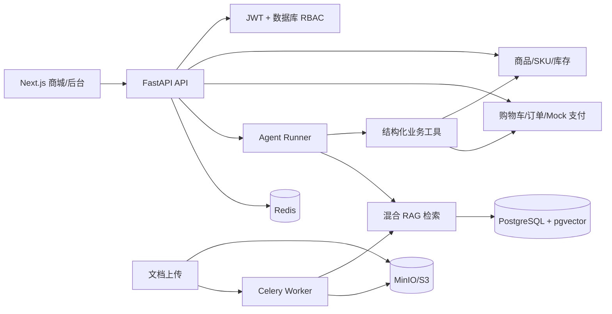

# FashionRAG 架构与关键流程

FashionRAG 采用模块化单体：Next.js 顾客商城和运营后台通过 FastAPI 访问同一业务边界；商品、库存、订单是关系数据库事实源；知识文档经过对象存储、解析、分块和 Embedding 后进入 pgvector（本地 SQLite 使用确定性 Mock 检索）；Redis/Celery 负责生产环境的异步索引。

## 订单下单时序

见 [`diagrams/order-checkout-sequence.mmd`](diagrams/order-checkout-sequence.mmd)。核心保证是同一用户和幂等键只落一笔订单，库存扣减和订单明细在同一事务中完成。

## Agent/RAG 时序

见 [`diagrams/agent-rag-sequence.mmd`](diagrams/agent-rag-sequence.mmd)。模型只能通过结构化工具读取业务事实；知识检索结果必须携带文档版本和来源定位，检索不到证据时转人工。
